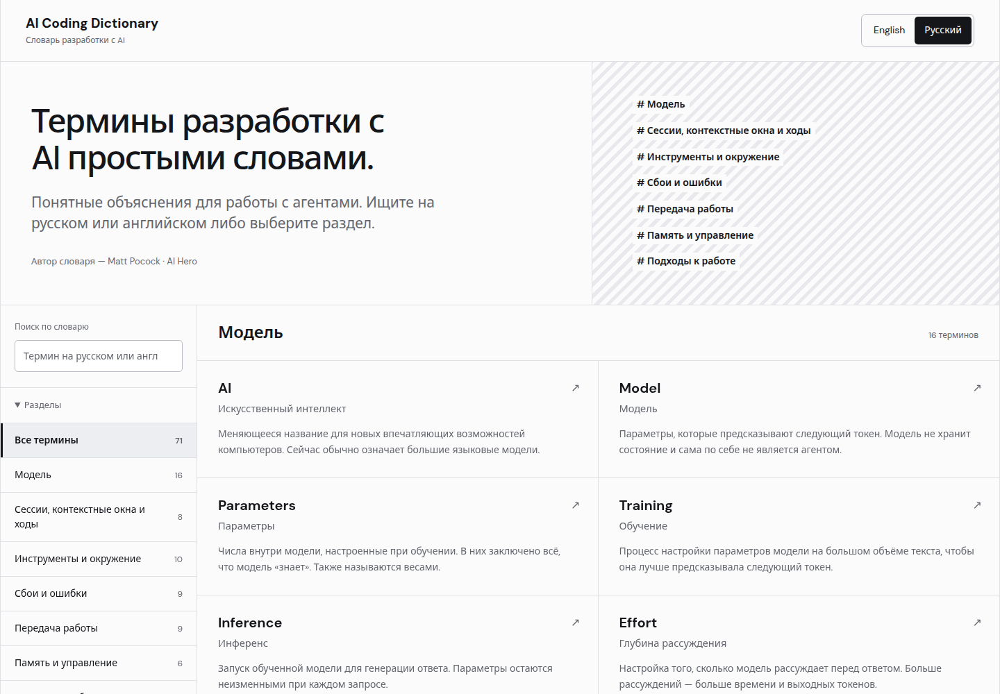
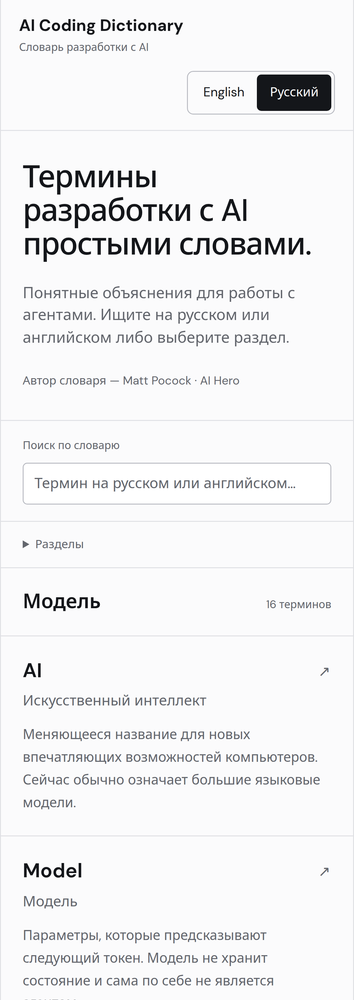
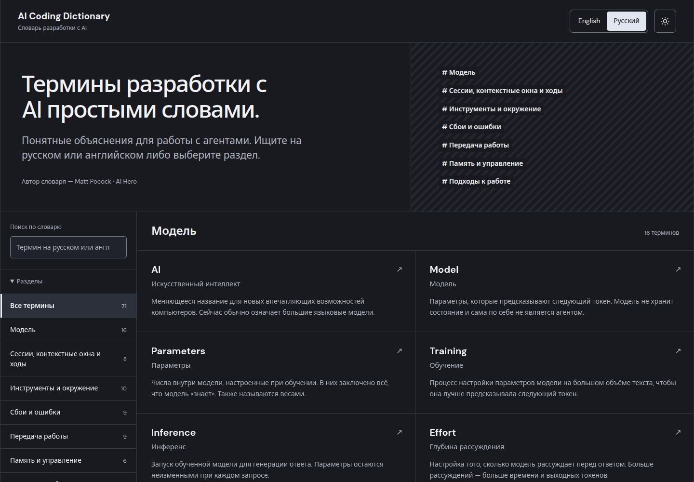
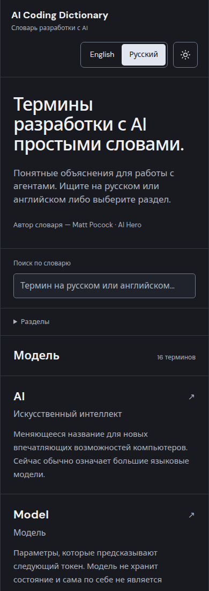

# Reader verification

Verified on 2026-10-19. Implementation, builds and browser checks ran on Dell.
No hosted CI or public deployment was used.

## Automated checks

`npm run check` passes:

- TypeScript checks for build scripts and browser JavaScript.
- Prettier formatting checks.
- Russian readability pass: 1,347 sentences; no descriptive sentence above the
  local 25-word target and no prose paragraph above six sentences.
- Seven regression tests covering translation coverage, UI key parity, bilingual
  search, aliases, Russian plural forms, links, code identifiers, legacy source
  metadata, source drift and missing translations.
- Static build: 71 complete English/Russian articles in seven sections.

All canonical English entry files and curriculum remain unchanged.
The generated README differs only by the fork's reader instructions.

The additional local Russian editorial checker flagged product names such as
Claude and Codex. These are retained deliberately because the original examples
refer to those products. This is not a claim of formal ASD-STE100 compliance.

## Browser checks

Checked in Chromium on Linux with desktop viewports and Pixel 10 touch emulation
at scale 1. Real iOS/Safari was not tested.

- All 142 article routes: 71 English and 71 Russian. Canonical English headings,
  smaller Russian subtitles, complete rendered bodies, language tags and links.
- Layouts at 320, 390, 768 and 1440 CSS pixels. No page overflow in the grids,
  five longest Russian headings or any of the 18 table articles.
- Language switching with mouse, Space, Enter and touch. Selected state,
  visible keyboard focus, document language, retained article and search query.
- Saved choice after reload and a fresh plain URL. Explicit URL language override.
- Search by English/Russian name, English alias and article text; empty results,
  clear button and Escape.
- Term cross-links, return to dictionary and browser Back/Forward.
- Skip-to-content navigation from English and Russian articles retains the
  article and focuses the main landmark.
- Local Cyrillic fonts and labeled, keyboard-scrollable table regions.
- No console errors, page errors, failed requests or external runtime requests.

Managed browser runs cleaned up their own processes and temporary profiles.

## Light theme: Russian desktop

## Light theme: Russian mobile

The section list is collapsed using the interface's disclosure control.

## Dark default and theme switching

The dark theme update passed 156 local browser assertions, including 88 responsive
cases and 24 contrast checks. Tests covered both languages and themes at
320, 390, 768 and 1440 CSS pixels, long Russian headings, tables and code.

- A fresh visit with a light system preference painted dark at first contentful
  paint. Saved light and dark preferences were applied before first paint, with
  no wrong-theme frames observed.
- Keyboard and touch switching, translated accessible button labels, visible
  focus, reload/deep-link persistence and cross-tab storage updates passed.
- Invalid or blocked storage fell back to dark. Switching still worked with
  blocked storage.
- Language, article and search behavior remained intact in both themes.
- Main dark text contrast is 15.41:1 and secondary text is 8.29:1. Tested control
  boundaries and focus indicators exceed 3:1 in both themes.
- No page overflow, console errors or page errors occurred.

Testing used desktop Chromium and mobile touch emulation on Linux, not a real
iPhone or Safari. The managed browser sessions cleaned up their own processes.

### Dark theme: Russian desktop

### Dark theme: Russian mobile

